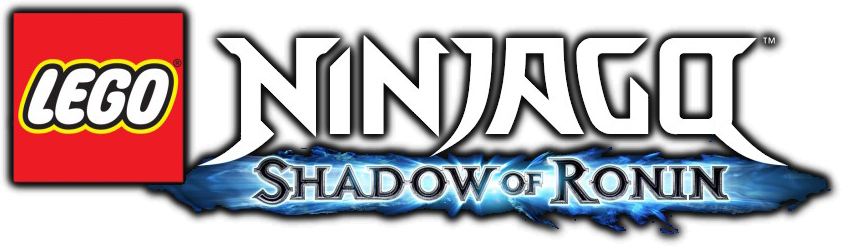

<div align=center>



</div>
<h1 align=center>LEGO Ninjago: Shadow of Ronin · Switch Port</h1>

A wrapper/port of the Android release of **LEGO Ninjago: Shadow of Ronin**
(package `com.wb.goog.lnjgo`, v2.2.1.02). It loads the original game binary
`libLEGO_Pixel_Mobile.so` (TT Games' "Fusion" engine), patches it and runs it
inside a minimal Android-like environment natively on the Switch.

No game code or assets are included in this repository.

### How to install

You need the **v2.2.1.02** Android release; extract from your own legally-owned
copy.

The port does **not** hardcode its folder — it finds its files next to wherever
the `.nro` is launched from, so you can install it in any folder. `/switch/lnsor/`
is the suggested spot. Put these files together in that one folder:

1. `libLEGO_Pixel_Mobile.so` (from the APK's `lib/arm64-v8a/`).
2. `assetpack1`, `assetpack2`, `assetpack3`, `assetpack4` (from the APK's
   `assets/`).
3. The port `.nro` (any filename, e.g. `lnsor.nro`).

Resulting layout (`/switch/lnsor/` used as the example):

```
/switch/lnsor/
  lnsor.nro
  libLEGO_Pixel_Mobile.so
  assetpack1
  assetpack2
  assetpack3
  assetpack4
  assets/           # created on the FIRST run; the extracted game assets
  config.txt        # created on first run
  save/             # created on first run; savegame
  write/            # created on first run
  cache/            # created on first run
```

### First run: asset extraction

Unlike the Batman port (whose assets were stored uncompressed and served
straight from the zips), Shadow of Ronin's assetpacks are DEFLATE-compressed, so
they cannot be read in place. **On the first launch the port inflates them once
into an `assets/` folder next to the `.nro`** (about 1.7 GB), showing a text
progress screen. This takes a little while and needs roughly **1.7 GB of free SD
space** in addition to the assetpacks.

The extraction is resumable (interrupting and relaunching continues where it
left off) and only happens once — a `.extracted` marker is written when it
finishes. After that you may **delete `assetpack1..4`** to reclaim their space;
the game runs from the `assets/` folder alone.

You don't have to use the `assetpack*` zips at all: if you have a dump whose
assets are already extracted (loose files), just put them under `assets/` and
skip the assetpacks entirely — the port indexes whatever is there. Both a flat
`assets/<rel>` layout and the original `assets/files/assetpacks/.../22102/22102/
assets/<rel>` tree are recognised.

### Notes

The port reads `/switch/lnsor_nx/config.txt`, created on first run:

* `screen_width` / `screen_height` — render resolution; `-1` auto-picks
  1280x720 handheld / 1920x1080 docked.
* `language` — `-1` follows the console language; otherwise an index
  (`0` en, `1` fr, `2` de, `3` it, `4` es, `5` nl, `6` da, `7` pt-BR, `8` ru,
  `9` tr, `10` ja, `11` zh, `12` ko).
* `show_fps` — `1` draws a small FPS counter in the top-left corner.
* `native_res` — `1` (default) renders the scene at full window resolution;
  `0` keeps the engine's mobile downscale.

### How to build

Install the devkitPro Switch toolchain and portlibs:

```sh
pacman -S devkitA64 switch-tools libnx switch-sdl2 switch-mesa switch-libdrm_nouveau
```

Then `make`.

### Credits

* TheOfficialFloW for the original Android so-loader (gtasa_vita).
* gm666q for the PS Vita so-loader groundwork and the OpenSL ES build.
* fgsfds for max_nx / the Switch so-loader groundwork reused here.

### Support

If you enjoy my work and want to support me :

[](https://ko-fi.com/D1D1P2MOG)

### Legal

This project has no affiliation with TT Games, Warner Bros., or the LEGO Group.
"LEGO Ninjago: Shadow of Ronin" and related marks belong to their respective
owners. No assets or program code from the original game or its Android port are
included here. We do not condone piracy; users must own a legal copy of the game.